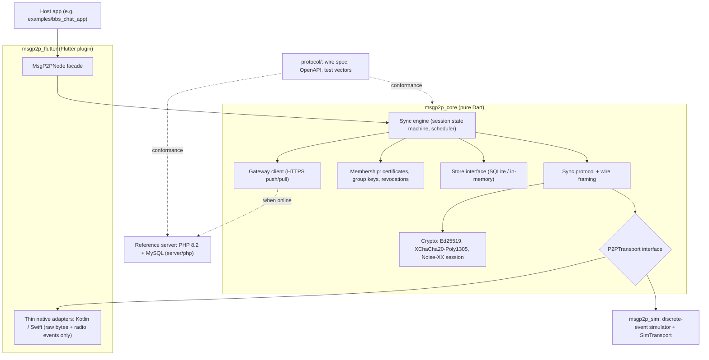
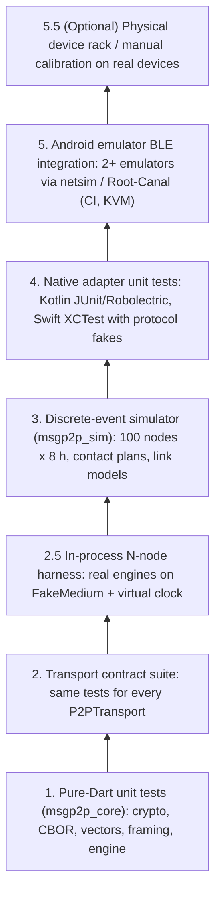

# msgp2p: Architecture

> Status: **Draft v2** — revised after plan evaluation (2026-10-18).
> See [requirements.md](requirements.md) for requirement IDs referenced here.

## 1. Overview



**Design principle: thin native, fat Dart.** Native code only advertises, scans, connects, moves byte chunks and reports events. Framing, chunking, retries, handshakes and sync logic are in Dart. They are written once, run identically on both platforms, and are fully testable without radios.

## 2. Repository Layout

```
msgp2p/
├── README.md, requirements.md, architecture.md
├── protocol/
│   ├── wire-format.md          # Envelope, certificate, session & sync message spec
│   ├── openapi.yaml            # Server HTTP API
│   └── test-vectors/           # JSON vectors shared by Dart and PHP tests
├── packages/
│   ├── msgp2p_core/            # Pure Dart engine
│   ├── msgp2p_sim/             # Pure Dart discrete-event simulator + CLI
│   └── msgp2p_flutter/         # Flutter plugin (android/ Kotlin, ios/ Swift)
├── examples/
│   └── bbs_chat_app/           # Reference app
├── server/
│   └── php/                    # Reference server + conformance test runner
└── tools/
    └── calibration/            # Manual field-calibration checklist & small Android probe app
```

## 3. Data Model

### 3.1 Envelope

```
Envelope {
  core: {                      // immutable; signed; id = SHA-256(canonical_cbor(core))
    v:          1
    group_id:   bytes16
    key_epoch:  uint
    author:     bytes32        // Ed25519 public key
    seq:        uint64         // per-author monotonic, starts at 1
    created_at: uint64 ms
    expires_at: uint64 ms      // default created_at + 24 h
    priority:   0..3           // 0 = SOS
    nonce:      bytes24
    ciphertext: bytes          // XChaCha20-Poly1305(group_key[epoch], cbor(payload), aad = core header)
    attachments:[{hash, size, mime}]   // references only, optional
  }
  sig:  bytes64                // Ed25519(author_sk, canonical_cbor(core))
  cert_ref: bytes32            // hash of author's membership certificate (full cert sent once per session)
}

payload (encrypted) { type: string, body: app-defined map }
```

- Encoding: deterministic CBOR (RFC 8949 §4.2), then optional zstd/deflate on session frames.
- Size: `canonical_cbor(core)` ≤ 4 KB hard limit (target ≤ 2 KB).
- **No mutable fields are signed** (FR-SEC-05). Relays never modify envelopes.
- `payload.type` is encrypted, so relays and eavesdroppers can't see message kinds. Only `priority` is in clear.

### 3.2 Membership Certificate

```
Cert { v, group_id, user_id, member_pubkey, role, issued_at, expires_at, server_sig }
```
`server_sig` is verified against the **pinned server key**. Revocation notices are server-signed envelopes with `priority = 1` that spread like normal messages.

### 3.3 Server Receipt

```
Receipt { group_id, author, ranges: [[from_seq, to_seq], ...], issued_at, server_sig }
```

### 3.4 Version Vector

```
VersionVector { author → { contiguous: uint64, extra: sorted set<uint64> } }
```
About 100 authors × ~10 bytes ≈ 1–2 KB. Exact, with no false positives (FR-SYNC-02).

## 4. Peer Session Protocol

```mermaid
sequenceDiagram
    autonumber
    participant A as Node A
    participant B as Node B
    Note over A,B: Discovery: BLE adv carries rotating token HMAC(group_beacon_key, window)
    A->>B: connect (GATT/L2CAP on Android; PHY chosen by RSSI)
    A->>B: HELLO (Noise XX msg 1: ephemeral key)
    B->>A: Noise XX msg 2 (+ B cert, signed)
    A->>B: Noise XX msg 3 (+ A cert, signed)
    Note over A,B: Encrypted session established, both certs valid and same group
    A->>B: SUMMARY (version vector, receipt watermark, revocation list version)
    B->>A: SUMMARY
    A->>B: WANT (missing author/seq ranges, by priority)
    B->>A: WANT
    B->>A: DATA (envelopes, chunked to MTU, priority order)
    A->>B: DATA
    A->>B: RECEIPTS / REVOCATIONS (if newer)
    A->>B: BYE (or link drops: resume next encounter)
```

- Framing: `[type:u8][len:varint][payload]`. Large frames are split into MTU-sized chunks with sequence + CRC, implemented in Dart.
- Each received envelope is checked in this order: size limit → cert valid and not revoked → signature → `created_at` not > now + 10 min → not expired → dedupe by id → store (one transaction per batch).
- Decryption happens only when the app reads the message. Relaying needs no decryption.
- **Fault resilience & connection slot management**: Transports enforce `maxConnections = 4`. Flapping or repeatedly failing peers incur in-memory exponential back-off (cooldown) to avoid saturating connection slots and blocking healthy peers.
- **Resumable transfer**: A dropped connection loses at most the in-flight chunk. The next encounter exchanges fresh version vectors and resumes seamlessly without re-sending completed envelopes.

## 5. Transports

### 5.1 `P2PTransport` interface (Dart)

```dart
abstract interface class P2PTransport {
  TransportCapabilities get capabilities;   // mtu, maxConnections, supportsBulk, ...
  Stream<PeerAdvert> get discovered;        // token, rssi, transport hints
  Future<void> startAdvertising(Uint8List token);
  Future<void> startScanning(ScanPolicy policy);
  Future<void> stop();
  Future<PeerLink> connect(PeerAdvert peer);
  Stream<PeerLink> get incoming;
}

abstract interface class PeerLink {
  int get mtu;
  Stream<Uint8List> get rx;                 // raw chunks
  Future<void> send(Uint8List chunk);
  Future<void> close();
  Stream<LinkEvent> get events;             // rssi, phy change, closed(reason)
}
```

### 5.2 Implementations

| Transport | Release | Notes |
| :--- | :--- | :--- |
| `FakeTransport` | v0.1 | In-memory, for unit tests |
| `SimTransport` | v0.1 | Driven by `msgp2p_sim` contact plan and link model |
| `AndroidBleTransport` | v0.1 | Extended advertising; 1M/2M/Coded PHY selection; L2CAP CoC with GATT fallback; foreground service `connectedDevice` |
| `IosBleTransport` | v0.2 | CoreBluetooth, **foreground participation**; background is best-effort (iOS overflow-area advertising is not discoverable by Android) |
| `WifiAwareTransport` | v0.2 | Android 8+ (`WifiAwareManager`) / iOS 26+ (Wi-Fi Aware framework, iPhone 12+). Used for large backlogs and attachments. Negotiated after a BLE session exists |
| `LoRaTransport` | Future | External Meshtastic/LoRa module bridge |

### 5.3 Transport selection
1. Discovery and small deltas: BLE.
2. If the pending delta exceeds a threshold (default 256 KB) or attachments are wanted **and** both peers support Wi-Fi Aware: upgrade the session to Wi-Fi Aware, then tear it down when done.
3. Android PHY: Coded PHY scanning for discovery at range; switch to 1M/2M when RSSI > threshold.

## 6. Storage (mobile SQLite, WAL)

```sql
CREATE TABLE envelopes (
  id            BLOB PRIMARY KEY,         -- SHA-256(core)
  author        BLOB NOT NULL,
  seq           INTEGER NOT NULL,
  created_at    INTEGER NOT NULL,
  expires_at    INTEGER NOT NULL,
  priority      INTEGER NOT NULL,
  key_epoch     INTEGER NOT NULL,
  raw           BLOB NOT NULL,            -- full encoded envelope
  origin        TEXT NOT NULL CHECK (origin IN ('LOCAL','PEER','SERVER')),
  first_handed_at INTEGER,                -- first time given to any peer (status: Handed to peer)
  server_confirmed INTEGER NOT NULL DEFAULT 0,
  UNIQUE (author, seq)
);
CREATE INDEX idx_env_prio ON envelopes(priority, created_at DESC);
CREATE INDEX idx_env_expiry ON envelopes(expires_at);

CREATE TABLE certs       (hash BLOB PRIMARY KEY, raw BLOB NOT NULL, expires_at INTEGER NOT NULL);
CREATE TABLE receipts    (author BLOB, from_seq INTEGER, to_seq INTEGER, raw BLOB, PRIMARY KEY(author, from_seq));
CREATE TABLE revocations (member_pubkey BLOB PRIMARY KEY, raw BLOB NOT NULL);
CREATE TABLE group_keys  (epoch INTEGER PRIMARY KEY, wrapped_key BLOB NOT NULL, valid_until INTEGER);

-- Tier 1: Anonymous raw sightings (retained <= 24 h, periodic pruning)
CREATE TABLE peer_sightings (
  token         BLOB NOT NULL,
  seen_at       INTEGER NOT NULL,
  transport     TEXT NOT NULL,
  rssi          INTEGER,
  PRIMARY KEY (token, seen_at)
);
CREATE INDEX idx_sightings_seen ON peer_sightings(seen_at);

-- Tier 2: Authenticated member daily statistics (retained 90 days, periodic pruning)
CREATE TABLE peer_daily_stats (
  member_pubkey   BLOB NOT NULL,
  day_date        INTEGER NOT NULL,       -- UTC midnight timestamp
  sessions_count  INTEGER NOT NULL DEFAULT 0,
  failed_connects INTEGER NOT NULL DEFAULT 0,
  flap_count      INTEGER NOT NULL DEFAULT 0,
  bytes_sent      INTEGER NOT NULL DEFAULT 0,
  bytes_recv      INTEGER NOT NULL DEFAULT 0,
  PRIMARY KEY (member_pubkey, day_date)
);
CREATE INDEX idx_daily_stats_date ON peer_daily_stats(day_date);

CREATE TABLE local_state (k TEXT PRIMARY KEY, v BLOB);   -- own seq counter, server vector, etc.
```

The version vector is derived from `(author, seq)` and cached in memory.

### Peer History & Retention Tiers
- **Tier 1 (Raw sightings):** Stored in `peer_sightings`. Kept for <= 24 hours (capped rows). Drives nearby peer discovery and the peer radar UI.
- **Tier 2 (Member statistics):** Stored in `peer_daily_stats`. Populated only after mutual certificate authentication. Aggregated per member public key per UTC day and retained for 90 days (configurable).
- **Tier 3 (Ephemeral session & back-off):** In-memory per-peer connection failure counters and exponential cooldown timers; cleared on app restart.

### Eviction Semantics & Reconciliation
- When local storage exceeds the 100 MB quota, pruning evicts envelopes by priority/age per FR-SYNC-05.
- The in-memory version vector exposes the evicted sequence numbers as sparse gaps.
- Re-fetching evicted messages from peers is permitted but bounded (`E_max` limit) to prevent cyclical re-sync ping-pong.

## 7. Reference Server (PHP)

- PHP 8.2+, PDO MySQL, `ext-sodium` for Ed25519 / XChaCha20. No framework.
- Tables: `users`, `group_members(pubkey, cert, revoked)`, `group_keys(epoch, key_enc)`, `envelopes(id, author, seq, raw, received_at)`, `receipts`.
- `sync/push`: verify cert + signature, `INSERT IGNORE` by id, return signed receipt ranges.
- `sync/pull?vector=...`: return envelopes beyond the client's server vector (paged).
- The server can decrypt content (it holds group keys) for the HQ dashboard. This is the trusted-operator model, FR-SEC-09.
- Conformance: `server/php/tests/` replays `protocol/test-vectors/`.

## 8. Testing Architecture

Most testing happens in pure Dart. Real hardware is only for calibration.



| Layer | Runs in CI | What it proves | What it cannot prove |
| :--- | :--- | :--- | :--- |
| 1 Unit | ✅ every push | Correctness of logic | Multi-node interactions |
| 2 Contract | ✅ every push | Every transport behaves identically to the engine | Network dynamics |
| 2.5 In-process harness | ✅ every push | Real engine multi-node convergence, partition merge, resume, race tie-breaks | Radio physics |
| 3 Simulator | ✅ every push / nightly | 100-node scale, 8 h partition scenarios, convergence ratios, quota pressure | Native OS stack quirks |
| 4 Native unit | ✅ PRs touching native | Adapter state handling, permissions, error paths | Multi-device interop |
| 5 Emulator | ✅ nightly / PR label | Real Android BLE stack via netsim/Root-Canal, GATT/L2CAP, dual-device sync | Coded PHY range, OEM hardware quirks, iOS |
| 5.5 Device rack / calibration | ❌ manual / optional | Real-world range, throughput, battery, hardware calibration profiles | Fast automated feedback |

### 8.1 In-process multi-node harness & unified scenario format
- **Unified Scenario Schema (YAML):** Shared across in-process harness, discrete simulator (`msgp2p_sim`), and emulator runners: defines nodes, contact plan, online windows, and message load.
- **Unified Trace Schema (JSONL):** Structured event traces (`published`, `received`, `stored`, `evicted`, `receipt_applied`, `session_start`, `session_end`) collected identically across all test backends, evaluated by a shared assertion and metrics analyzer.
- **`FakeMedium` Fault Injection:** Dynamic topology graph (runtime connect/disconnect), seeded packet drop/latency, and `cutLink(afterBytes: n)` for verifying mid-transfer resume (FR-SYNC-04).

### 8.2 Simulator design (`msgp2p_sim`)
- **Virtual clock and event queue**, so runs are deterministic and reproducible from a seed.
- **Contact plans:** scripted (`A meets B at t=10 min for 90 s`) or generated from mobility models (group walking, trail with passing hikers, ridge gateway with periodic Internet).
- **Link model per contact:** connect latency, bandwidth, MTU, loss, from `link_profiles.yaml` (e.g. `ble_1m`, `ble_coded_s8`, `wifi_aware`). Calibration updates these profiles.
- **Server model:** an in-memory server implementing the same protocol, reachable only by nodes in an "online" state.
- **Assertions and metrics:** delivery ratio, latency to server, per-node storage, bytes on air, duplicates.
- CLI: `dart run msgp2p_sim --scenario scenarios/ridge_gateway.yaml --seed 42`.

### 8.3 Emulator integration
- CI job starts two emulator instances with `-packet-streamer-endpoint default` so they share one virtual Bluetooth medium (netsim / Root-Canal).
- Instrumentation tests run the reference app's test harness: A publishes N messages, B must receive all within a time limit.
- Coded PHY / L2CAP support in the virtual controller must be confirmed. If it isn't available, the emulator tests use 1M PHY + GATT, and Coded PHY is covered by calibration only.
- The iOS Simulator has no Bluetooth, so iOS adapters rely on layer 4 plus manual calibration.
